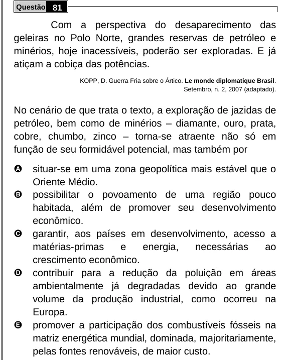

Texto extraído (pode conter ruído)

Questão 81  
Com a perspectiva do desaparecimento das  
geleiras no Polo Norte, grandes reservas de petróleo e  
minérios, hoje inacessíveis, poderão ser exploradas. E já  
atiçam a cobiça das potências.  
KOPP, D. Guerra Fria sobre o Ártico. Le monde diplomatique Brasil.  
Setembro, n. 2, 2007 (adaptado).  
No cenário de que trata o texto, a exploração de jazidas de  
petróleo, bem como de minérios – diamante, ouro, prata,  
cobre, chumbo, zinco – torna-se atraente não só em  
função de seu formidável potencial, mas também por  
A  
situar-se em uma zona geopolítica mais estável que o  
Oriente Médio.  
B  
possibilitar o povoamento de uma região pouco  
habitada, além de promover seu desenvolvimento  
econômico.  
C  
garantir, aos países em desenvolvimento, acesso a  
matérias-primas  
e  
energia,  
necessárias  
ao  
crescimento econômico.  
D  
contribuir para a redução da poluição em áreas  
ambientalmente já degradadas devido ao grande  
volume da produção industrial, como ocorreu na  
Europa.  
E  
promover a participação dos combustíveis fósseis na  
matriz energética mundial, dominada, majoritariamente,  
pelas fontes renováveis, de maior custo.

