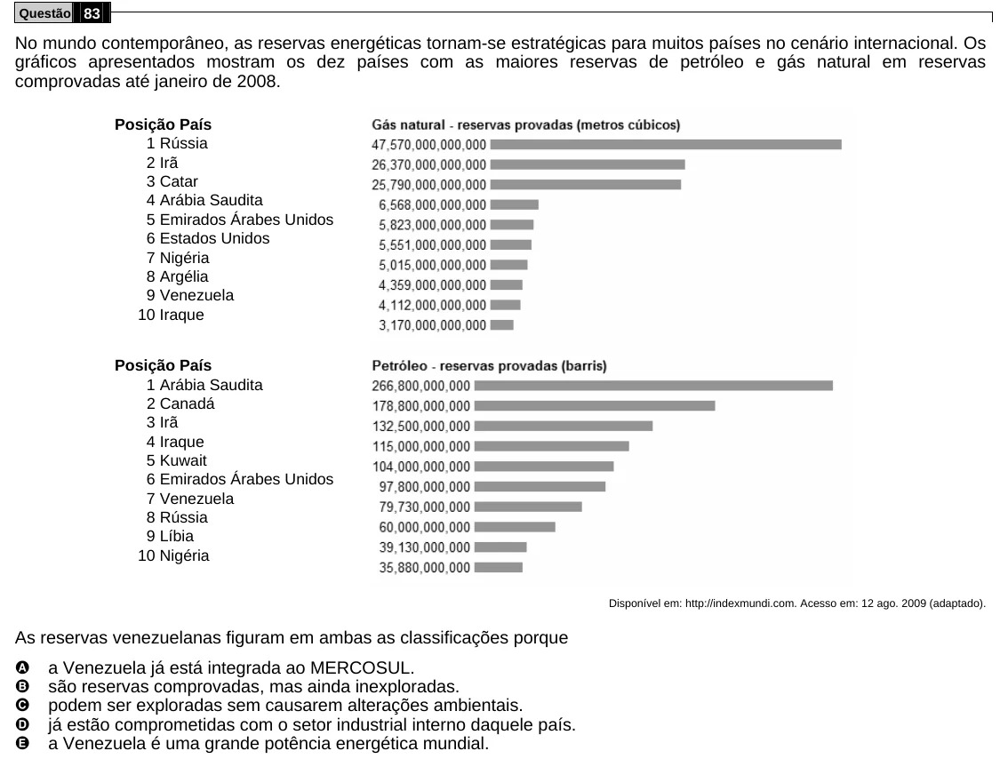

Texto extraído (pode conter ruído)

Questão 83  
No mundo contemporâneo, as reservas energéticas tornam-se estratégicas para muitos países no cenário internacional. Os  
gráficos apresentados mostram os dez países com as maiores reservas de petróleo e gás natural em reservas  
comprovadas até janeiro de 2008.  
Posição País  
1 Rússia  
2 Irã  
3 Catar  
4 Arábia Saudita  
5 Emirados Árabes Unidos  
6 Estados Unidos  
7 Nigéria  
8 Argélia  
9 Venezuela  
10 Iraque  
Posição País  
1 Arábia Saudita  
2 Canadá  
3 Irã  
4 Iraque  
5 Kuwait  
6 Emirados Árabes Unidos  
7 Venezuela  
8 Rússia  
9 Líbia  
10 Nigéria  
Disponível em: http://indexmundi.com. Acesso em: 12 ago. 2009 (adaptado).  
As reservas venezuelanas figuram em ambas as classificações porque  
A  
a Venezuela já está integrada ao MERCOSUL.  
B  
são reservas comprovadas, mas ainda inexploradas.  
C  
podem ser exploradas sem causarem alterações ambientais.  
D  
já estão comprometidas com o setor industrial interno daquele país.  
E  
a Venezuela é uma grande potência energética mundial.

