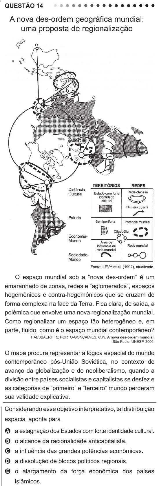

Texto extraído (pode conter ruído)

QUESTÃO 14  
O espaço mundial sob a “nova des-ordem” é um  
emaranhado de zonas, redes e “aglomerados”, espaços  
hegemônicos e contra-hegemônicos que se cruzam de  
forma complexa na face da Terra. Fica clara, de saída, a  
polêmica que envolve uma nova regionalização mundial.  
Como regionalizar um espaço tão heterogêneo e, em  
parte, fluido, como é o espaço mundial contemporâneo?  
HAESBAERT, R.; PORTO-GONÇALVES, C.W. A nova des-ordem mundial.  
São Paulo: UNESP, 2006.  
O mapa procura representar a lógica espacial do mundo  
contemporâneo pós-União Soviética, no contexto de  
avanço da globalização e do neoliberalismo, quando a  
divisão entre países socialistas e capitalistas se desfez e  
as categorias de “primeiro” e “terceiro” mundo perderam  
sua validade explicativa.  
Considerando esse objetivo interpretativo, tal distribuição  
espacial aponta para  
A a estagnação dos Estados com forte identidade cultural.  
B o alcance da racionalidade anticapitalista.  
C a influência das grandes potências econômicas.  
D a dissolução de blocos políticos regionais.  
E o alargamento da força econômica dos países  
islâmicos.

