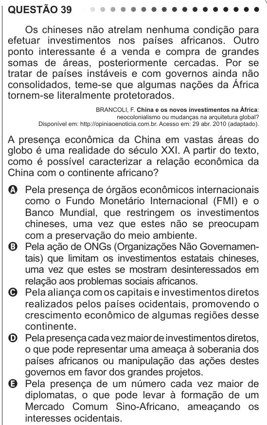

Texto extraído (pode conter ruído)

QUESTÃO 39  
Os chineses não atrelam nenhuma condição para  
efetuar investimentos nos países africanos. Outro  
ponto interessante é a venda e compra de grandes  
somas de áreas, posteriormente cercadas. Por se  
tratar de países instáveis e com governos ainda não  
consolidados, teme-se que algumas nações da África  
tornem-se literalmente protetorados.  
BRANCOLI, F. China e os novos investimentos na África:  
neocolonialismo ou mudanças na arquitetura global?  
Disponível em: http://opiniaoenoticia.com.br. Acesso em: 29 abr. 2010 (adaptado).  
A presença econômica da China em vastas áreas do  
globo é uma realidade do século XXI. A partir do texto,  
como é possível caracterizar a relação econômica da  
China com o continente africano?  
A Pela presença de órgãos econômicos internacionais  
como o Fundo Monetário Internacional (FMI) e o  
Banco Mundial, que restringem os investimentos  
chineses, uma vez que estes não se preocupam  
com a preservação do meio ambiente.  
B Pela ação de ONGs (Organizações Não Governamen-  
tais) que limitam os investimentos estatais chineses,  
uma vez que estes se mostram desinteressados em  
relação aos problemas sociais africanos.  
C Pela aliança com os capitais e investimentos diretos  
realizados pelos países ocidentais, promovendo o  
crescimento econômico de algumas regiões desse  
continente.  
D Pela presença cada vez maior de investimentos diretos,  
o que pode representar uma ameaça à soberania dos  
países africanos ou manipulação das ações destes  
governos em favor dos grandes projetos.  
E Pela presença de um número cada vez maior de  
diplomatas, o que pode levar à formação de um  
Mercado Comum Sino-Africano, ameaçando os  
interesses ocidentais.

