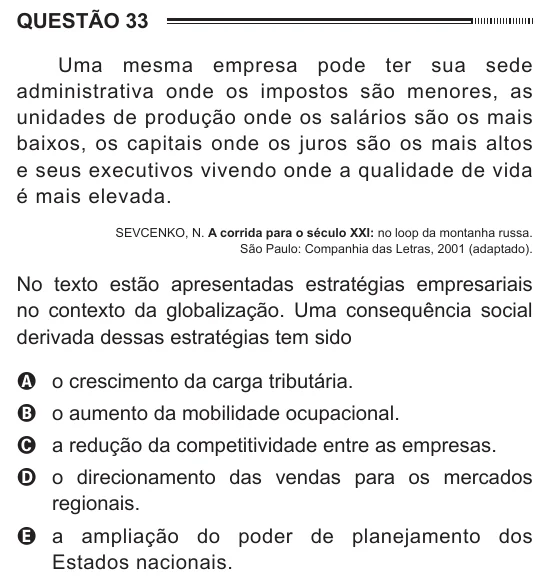

Texto extraído (pode conter ruído)

QUESTÃO 33  
Uma mesma empresa pode ter sua sede  
administrativa onde os impostos são menores, as  
unidades de produção onde os salários são os mais  
baixos, os capitais onde os juros são os mais altos  
e seus executivos vivendo onde a qualidade de vida  
é mais elevada.  
SEVCENKO, N. A corrida para o século XXI: no loop da montanha russa.  
São Paulo: Companhia das Letras, 2001 (adaptado).  
No texto estão apresentadas estratégias empresariais  
no contexto da globalização. Uma consequência social  
derivada dessas estratégias tem sido  
A o crescimento da carga tributária.  
B o aumento da mobilidade ocupacional.  
C a redução da competitividade entre as empresas.  
D o direcionamento das vendas para os mercados  
regionais.  
E a ampliação do poder de planejamento dos  
Estados nacionais.

