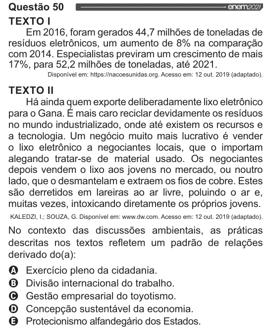

Texto extraído (pode conter ruído)

Questão 50  
TEXTO |  
Em 2016, foram gerados 44,7 milhões de toneladas de  
resíduos eletrônicos, um aumento de 8% na comparação  
com 2014. Especialistas previram um crescimento de mais  
17%, para 52,2 milhões de toneladas, até 2021.  
Disponível em: https://nacoesunidas.org. Acesso em: 12 out. 2019 (adaptado).  
TEXTO II  
Há ainda quem exporte deliberadamente lixo eletrônico  
para o Gana. E mais caro reciclar devidamente os resíduos  
no mundo industrializado, onde até existem os recursos e  
a tecnologia. Um negócio muito mais lucrativo é vender  
o lixo eletrônico a negociantes locais, que o importam  
alegando tratar-se de material usado. Os negociantes  
depois vendem o lixo aos jovens no mercado, ou noutro  
lado, que o desmantelam e extraem os fios de cobre. Estes  
são derretidos em lareiras ao ar livre, poluindo o ar e,  
muitas vezes, intoxicando diretamente os próprios jovens.  
KALEDZI, |.; SOUZA, G. Disponível em: www.dw.com. Acesso em: 12 out. 2019 (adaptado).  
No contexto das discussões ambientais, as práticas  
descritas nos textos refletem um padrão de relações  
derivado do(a):  
OQ Exercício pleno da cidadania.  
O Divisão internacional do trabalho.  
O Gestão empresarial do toyotismo.  
O Concepção sustentável da economia.  
& Protecionismo alfandegário dos Estados.

