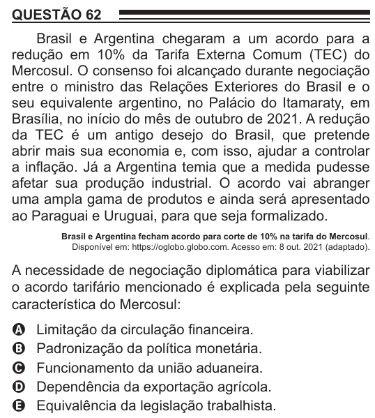

Texto extraído (pode conter ruído)

QUESTÃO 62  
Brasil e Argentina chegaram a um acordo para a  
redução em 10% da Tarifa Externa Comum (TEC) do  
Mercosul. O consenso foi alcançado durante negociação  
entre o ministro das Relações Exteriores do Brasil e o  
seu equivalente argentino, no Palácio do Itamaraty, em  
Brasília, no início do mês de outubro de 2021. A redução  
da TEC é um antigo desejo do Brasil, que pretende  
abrir mais sua economia e, com isso, ajudar a controlar  
a inflação. Já a Argentina temia que a medida pudesse  
afetar sua produção industrial. O acordo vai abranger  
uma ampla gama de produtos e ainda será apresentado  
ao Paraguai e Uruguai, para que seja formalizado.  
Brasil e Argentina fecham acordo para corte de 10% na tarifa do Mercosul.  
Disponível em: https://oglobo.globo.com. Acesso em: 8 out. 2021 (adaptado).  
A necessidade de negociação diplomática para viabilizar  
o acordo tarifário mencionado é explicada pela seguinte  
característica do Mercosul:  
Limitação da circulação financeira.  
A  
Padronização da política monetária.  
B  
C  
Funcionamento da união aduaneira.  
Dependência da exportação agrícola.  
D  
Equivalência da legislação trabalhista.  
E

