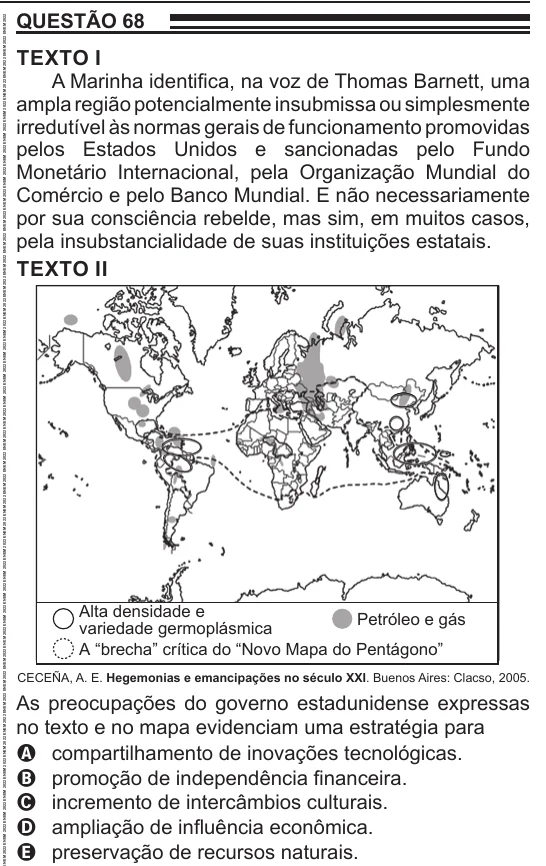

Texto extraído (pode conter ruído)

QUESTÃO 68  
TEXTO I  
A Marinha identifica, na voz de Thomas Barnett, uma  
ampla região potencialmente insubmissa ou simplesmente  
irredutível às normas gerais de funcionamento promovidas  
pelos Estados Unidos e sancionadas pelo Fundo  
Monetário Internacional, pela Organização Mundial do  
Comércio e pelo Banco Mundial. E não necessariamente  
por sua consciência rebelde, mas sim, em muitos casos,  
pela insubstancialidade de suas instituições estatais.  
TEXTO II  
Alta densidade e  
Petróleo e gás  
variedade germoplásmica  
A “brecha” crítica do “Novo Mapa do Pentágono”  
CECEÑA, A. E. Hegemonias e emancipações no século XXI. Buenos Aires: Clacso, 2005.  
As preocupações do governo estadunidense expressas  
no texto e no mapa evidenciam uma estratégia para  
A compartilhamento de inovações tecnológicas.  
B promoção de independência financeira.  
C incremento de intercâmbios culturais.  
D ampliação de influência econômica.  
E preservação de recursos naturais.

