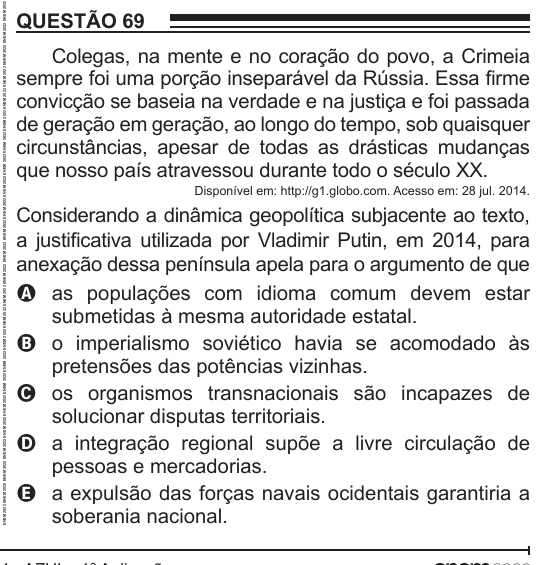

Texto extraído (pode conter ruído)

QUESTÃO 69  
Colegas, na mente e no coração do povo, a Crimeia  
sempre foi uma porção inseparável da Rússia. Essa firme  
convicção se baseia na verdade e na justiça e foi passada  
de geração em geração, ao longo do tempo, sob quaisquer  
circunstâncias, apesar de todas as drásticas mudanças  
que nosso país atravessou durante todo o século XX.  
Disponível em: http://g1.globo.com. Acesso em: 28 jul. 2014.  
Considerando a dinâmica geopolítica subjacente ao texto,  
a justificativa utilizada por Vladimir Putin, em 2014, para  
anexação dessa península apela para o argumento de que  
A as populações com idioma comum devem estar  
submetidas à mesma autoridade estatal.  
B o imperialismo soviético havia se acomodado às  
pretensões das potências vizinhas.  
C os organismos transnacionais são incapazes de  
solucionar disputas territoriais.  
D a integração regional supõe a livre circulação de  
pessoas e mercadorias.  
E a expulsão das forças navais ocidentais garantiria a  
soberania nacional.

