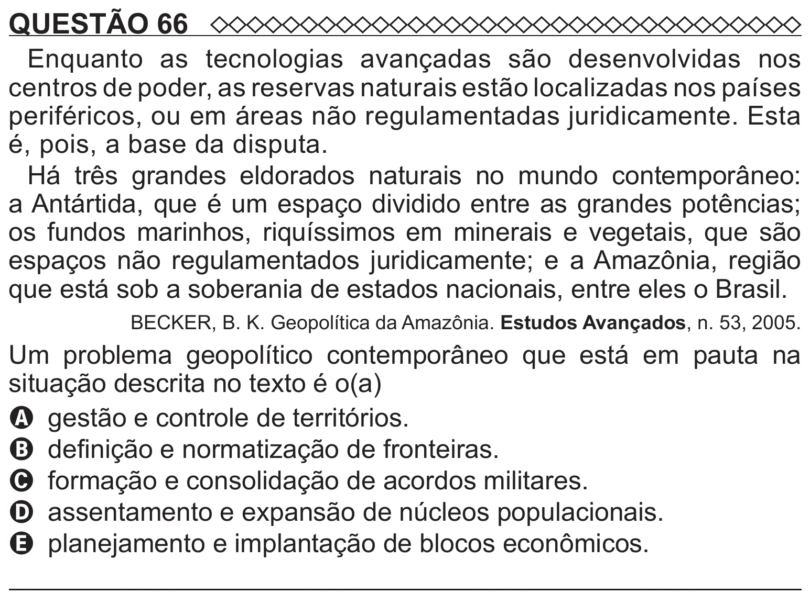

Texto extraído (pode conter ruído)

QUESTÃO 66  
Enquanto as tecnologias avançadas são desenvolvidas nos  
centros de poder, as reservas naturais estão localizadas nos países  
periféricos, ou em áreas não regulamentadas juridicamente. Esta  
é, pois, a base da disputa.  
Há três grandes eldorados naturais no mundo contemporâneo:  
a Antártida, que é um espaço dividido entre as grandes potências;  
os fundos marinhos, riquíssimos em minerais e vegetais, que são  
espaços não regulamentados juridicamente; e a Amazônia, região  
que está sob a soberania de estados nacionais, entre eles o Brasil.  
BECKER, B. K. Geopolítica da Amazônia. Estudos Avançados, n. 53, 2005.  
Um problema geopolítico contemporâneo que está em pauta na  
situação descrita no texto é o(a)  
A gestão e controle de territórios.  
B definição e normatização de fronteiras.  
C formação e consolidação de acordos militares.  
D assentamento e expansão de núcleos populacionais.  
E planejamento e implantação de blocos econômicos.

