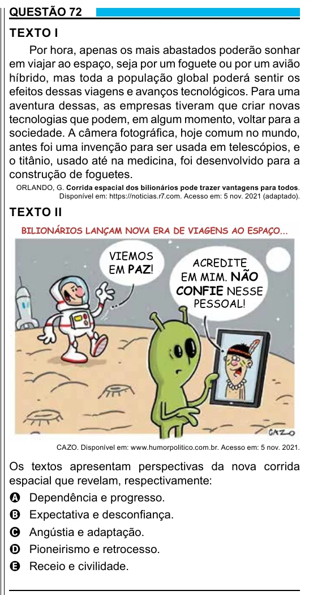

Texto extraído (pode conter ruído)

QUESTÃO 72  
TEXTO I  
Por hora, apenas os mais abastados poderão sonhar  
em viajar ao espaço, seja por um foguete ou por um avião  
híbrido, mas toda a população global poderá sentir os  
efeitos dessas viagens e avanços tecnológicos. Para uma  
aventura dessas, as empresas tiveram que criar novas  
tecnologias que podem, em algum momento, voltar para a  
sociedade. A câmera fotográfica, hoje comum no mundo,  
antes foi uma invenção para ser usada em telescópios, e  
o titânio, usado até na medicina, foi desenvolvido para a  
construção de foguetes.  
ORLANDO, G. Corrida espacial dos bilionários pode trazer vantagens para todos.  
Disponível em: https://noticias.r7.com. Acesso em: 5 nov. 2021 (adaptado).  
TEXTO II  
BILIONÁRIOS LANÇAM NOVA ERA DE VIAGENS AO ESPAÇO...  
VIEMOS  
ACREDITE  
EM PAZ!  
EM MIM. NÃO  
CONFIE NESSE  
PESSOAL!  
CAZO. Disponível em: www.humorpolitico.com.br. Acesso em: 5 nov. 2021.  
Os textos apresentam perspectivas da nova corrida  
espacial que revelam, respectivamente:  
A Dependência e progresso.  
B Expectativa e desconfiança.  
C Angústia e adaptação.  
D Pioneirismo e retrocesso.  
E Receio e civilidade.

