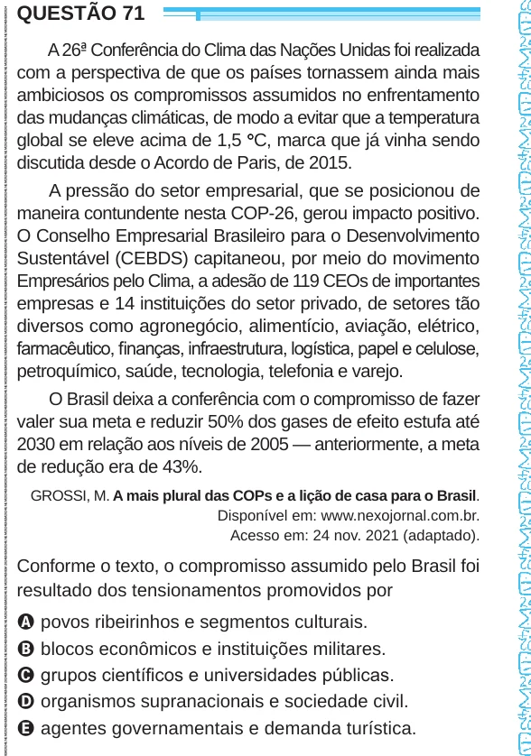

Texto extraído (pode conter ruído)

QUESTÃO 71  
A 26 ª Conferência do Clima das Nações Unidas foi realizada  
com a perspectiva de que os países tornassem ainda mais  
ambiciosos os compromissos assumidos no enfrentamento  
das mudanças climáticas, de modo a evitar que a temperatura  
global se eleve acima de 1,5 ° C, marca que já vinha sendo  
discutida desde o Acordo de Paris, de 2015.  
A pressão do setor empresarial, que se posicionou de  
maneira contundente nesta COP-26, gerou impacto positivo.  
O Conselho Empresarial Brasileiro para o Desenvolvimento  
Sustentável (CEBDS) capitaneou, por meio do movimento  
Empresários pelo Clima, a adesão de 119 CEOs de importantes  
empresas e 14 instituições do setor privado, de setores tão  
diversos como agronegócio, alimentício, aviação, elétrico,  
farmacêutico, finanças, infraestrutura, logística, papel e celulose,  
petroquímico, saúde, tecnologia, telefonia e varejo.  
O Brasil deixa a conferência com o compromisso de fazer  
valer sua meta e reduzir 50% dos gases de efeito estufa até  
2030 em relação aos níveis de 2005 — anteriormente, a meta  
de redução era de 43%.  
GROSSI, M. A mais plural das COPs e a lição de casa para o Brasil.  
Disponível em: www.nexojornal.com.br.  
Acesso em: 24 nov. 2021 (adaptado).  
Conforme o texto, o compromisso assumido pelo Brasil foi  
resultado dos tensionamentos promovidos por  
A povos ribeirinhos e segmentos culturais.  
B blocos econômicos e instituições militares.  
C grupos científicos e universidades públicas.  
D organismos supranacionais e sociedade civil.  
E agentes governamentais e demanda turística.

