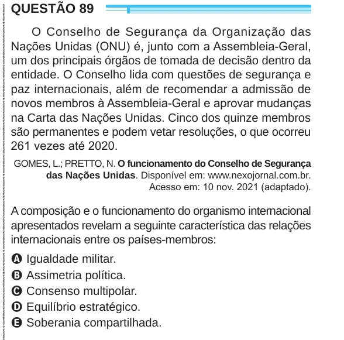

Texto extraído (pode conter ruído)

QUESTÃO 89  
O Conselho de Segurança da Organização das  
Nações Unidas (ONU) é, junto com a Assembleia-Geral,  
um dos principais órgãos de tomada de decisão dentro da  
entidade. O Conselho lida com questões de segurança e  
paz internacionais, além de recomendar a admissão de  
novos membros à Assembleia-Geral e aprovar mudanças  
na Carta das Nações Unidas. Cinco dos quinze membros  
são permanentes e podem vetar resoluções, o que ocorreu  
261 vezes até 2020.  
GOMES, L.; PRETTO, N. O funcionamento do Conselho de Segurança  
das Nações Unidas. Disponível em: www.nexojornal.com.br.  
Acesso em: 10 nov. 2021 (adaptado).  
A composição e o funcionamento do organismo internacional  
apresentados revelam a seguinte característica das relações  
internacionais entre os países-membros:  
A Igualdade militar.  
B Assimetria política.  
C Consenso multipolar.  
D Equilíbrio estratégico.  
E Soberania compartilhada.

