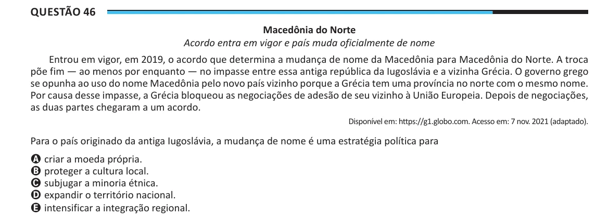

Texto extraído (pode conter ruído)

Questão 46  
Macedônia do Norte  
Acordo entra em vigor e país muda oficialmente de nome  
Entrou em vigor, em 2019, o acordo que determina a mudança de nome da Macedônia para Macedônia do Norte. A troca  
põe fim — ao menos por enquanto — no impasse entre essa antiga república da Iugoslávia e a vizinha Grécia. O governo grego  
se opunha ao uso do nome Macedônia pelo novo país vizinho porque a Grécia tem uma província no norte com o mesmo nome.  
Por causa desse impasse, a Grécia bloqueou as negociações de adesão de seu vizinho à União Europeia. Depois de negociações,  
as duas partes chegaram a um acordo.  
Disponível em: https://g1.globo.com. Acesso em: 7 nov. 2021 (adaptado).  
Para o país originado da antiga Iugoslávia, a mudança de nome é uma estratégia política para  
A criar a moeda própria.  
B proteger a cultura local.  
C subjugar a minoria étnica.  
D expandir o território nacional.  
E intensificar a integração regional.

