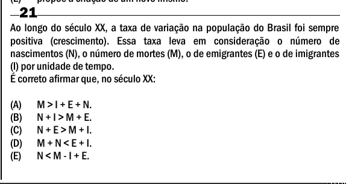

Texto extraído (pode conter ruído)

21  
Ao longo do século XX, a taxa de variação na população do Brasil foi sempre  
positiva (crescimento). Essa taxa leva em consideração o número de  
nascimentos (N), o número de mortes (M), o de emigrantes (E) e o de imigrantes  
(I) por unidade de tempo.  
É correto afirmar que, no século XX:  
(A)  
M > I + E + N.  
(B)  
N + I > M + E.  
(C)  
N + E > M + I.  
(D)  
M + N < E + I.  
(E)  
N < M - I + E.

