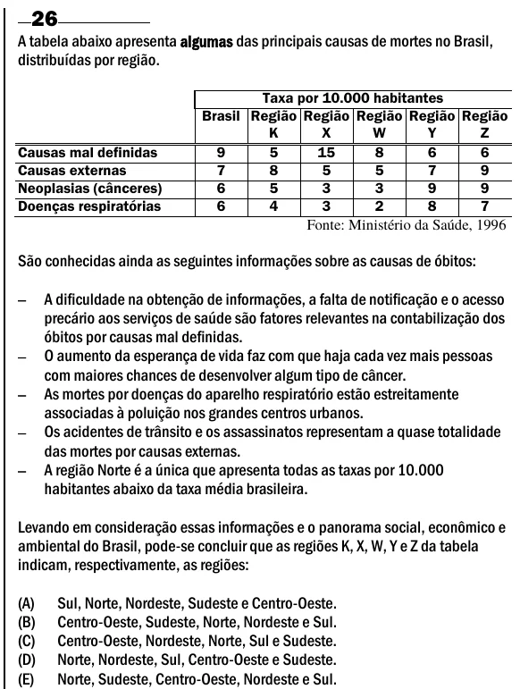

Texto extraído (pode conter ruído)

26  
A tabela abaixo apresenta algumas das principais causas de mortes no Brasil,  
distribuídas por região.  
Taxa por 10.000 habitantes  
Brasil Região Região Região Região Região  
K  
X  
W  
Y  
Z  
Causas mal definidas  
9  
5  
15  
8  
6  
6  
Causas externas  
7  
8  
5  
5  
7  
9  
Neoplasias (cânceres)  
6  
5  
3  
3  
9  
9  
Doenças respiratórias  
6  
4  
3  
2  
8  
7  
Fonte: Ministério da Saúde, 1996  
São conhecidas ainda as seguintes informações sobre as causas de óbitos:  
  
A dificuldade na obtenção de informações, a falta de notificação e o acesso  
precário aos serviços de saúde são fatores relevantes na contabilização dos  
óbitos por causas mal definidas.  
  
O aumento da esperança de vida faz com que haja cada vez mais pessoas  
com maiores chances de desenvolver algum tipo de câncer.  
  
As mortes por doenças do aparelho respiratório estão estreitamente  
associadas à poluição nos grandes centros urbanos.  
  
Os acidentes de trânsito e os assassinatos representam a quase totalidade  
das mortes por causas externas.  
  
A região Norte é a única que apresenta todas as taxas por 10.000  
habitantes abaixo da taxa média brasileira.  
Levando em consideração essas informações e o panorama social, econômico e  
ambiental do Brasil, pode-se concluir que as regiões K, X, W, Y e Z da tabela  
indicam, respectivamente, as regiões:  
(A)  
Sul, Norte, Nordeste, Sudeste e Centro-Oeste.  
(B)  
Centro-Oeste, Sudeste, Norte, Nordeste e Sul.  
(C)  
Centro-Oeste, Nordeste, Norte, Sul e Sudeste.  
(D)  
Norte, Nordeste, Sul, Centro-Oeste e Sudeste.  
(E)  
Norte, Sudeste, Centro-Oeste, Nordeste e Sul.

