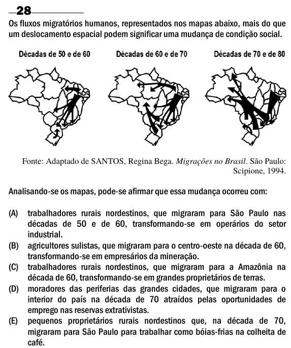

Texto extraído (pode conter ruído)

28  
Os fluxos migratórios humanos, representados nos mapas abaixo, mais do que  
um deslocamento espacial podem significar uma mudança de condição social.  
Fonte: Adaptado de SANTOS, Regina Bega. Migrações no Brasil. São Paulo:  
Scipione, 1994.  
Analisando-se os mapas, pode-se afirmar que essa mudança ocorreu com:  
(A) trabalhadores rurais nordestinos, que migraram para São Paulo nas  
décadas de 50 e de 60, transformando-se em operários do setor  
industrial.  
(B) agricultores sulistas, que migraram para o centro-oeste na década de 60,  
transformando-se em empresários da mineração.  
(C) trabalhadores rurais nordestinos, que migraram para a Amazônia na  
década de 60, transformando-se em grandes proprietários de terras.  
(D) moradores das periferias das grandes cidades, que migraram para o  
interior do país na década de 70 atraídos pelas oportunidades de  
emprego nas reservas extrativistas.  
(E) pequenos proprietários rurais nordestinos que, na década de 70,  
migraram para São Paulo para trabalhar como bóias-frias na colheita de  
café.

