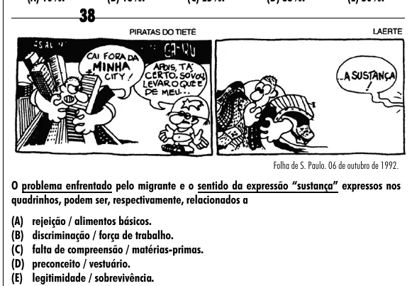

Texto extraído (pode conter ruído)

38  
Folha de S. Paulo. 06 de outubro de 1992.  
O problema enfrentado pelo migrante e o sentido da expressão “sustança” expressos nos  
quadrinhos, podem ser, respectivamente, relacionados a  
(A) rejeição / alimentos básicos.  
(B) discriminação / força de trabalho.  
(C) falta de compreensão / matérias-primas.  
(D) preconceito / vestuário.  
(E) legitimidade / sobrevivência.

