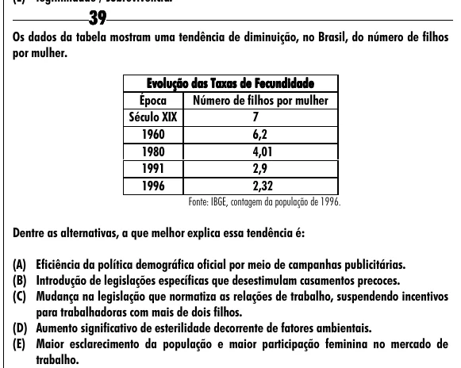

Texto extraído (pode conter ruído)

39  
Os dados da tabela mostram uma tendência de diminuição, no Brasil, do número de filhos  
por mulher.  
Evolução das Taxas de Fecundidade  
Época  
Número de filhos por mulher  
Século XIX  
7  
1960  
6,2  
1980  
4,01  
1991  
2,9  
1996  
2,32  
Fonte: IBGE, contagem da população de 1996.  
Dentre as alternativas, a que melhor explica essa tendência é:  
(A) Eficiência da política demográfica oficial por meio de campanhas publicitárias.  
(B) Introdução de legislações específicas que desestimulam casamentos precoces.  
(C) Mudança na legislação que normatiza as relações de trabalho, suspendendo incentivos  
para trabalhadoras com mais de dois filhos.  
(D) Aumento significativo de esterilidade decorrente de fatores ambientais.  
(E) Maior esclarecimento da população e maior participação feminina no mercado de  
trabalho.

