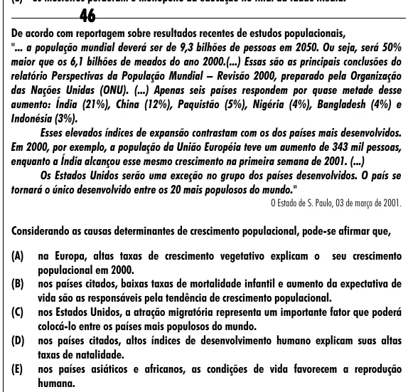

Texto extraído (pode conter ruído)

46  
De acordo com reportagem sobre resultados recentes de estudos populacionais,  
"... a população mundial deverá ser de 9,3 bilhões de pessoas em 2050. Ou seja, será 50%  
maior que os 6,1 bilhões de meados do ano 2000.(...) Essas são as principais conclusões do  
relatório Perspectivas da População Mundial – Revisão 2000, preparado pela Organização  
das Nações Unidas (ONU). (...) Apenas seis países respondem por quase metade desse  
aumento: Índia (21%), China (12%), Paquistão (5%), Nigéria (4%), Bangladesh (4%) e  
Indonésia (3%).  
Esses elevados índices de expansão contrastam com os dos países mais desenvolvidos.  
Em 2000, por exemplo, a população da União Européia teve um aumento de 343 mil pessoas,  
enquanto a Índia alcançou esse mesmo crescimento na primeira semana de 2001. (...)  
Os Estados Unidos serão uma exceção no grupo dos países desenvolvidos. O país se  
tornará o único desenvolvido entre os 20 mais populosos do mundo."  
O Estado de S. Paulo, 03 de março de 2001.  
Considerando as causas determinantes de crescimento populacional, pode-se afirmar que,  
(A)  
na Europa, altas taxas de crescimento vegetativo explicam o seu crescimento  
populacional em 2000.  
(B)  
nos países citados, baixas taxas de mortalidade infantil e aumento da expectativa de  
vida são as responsáveis pela tendência de crescimento populacional.  
(C)  
nos Estados Unidos, a atração migratória representa um importante fator que poderá  
colocá-lo entre os países mais populosos do mundo.  
(D)  
nos países citados, altos índices de desenvolvimento humano explicam suas altas  
taxas de natalidade.  
(E)  
nos países asiáticos e africanos, as condições de vida favorecem a reprodução  
humana.

