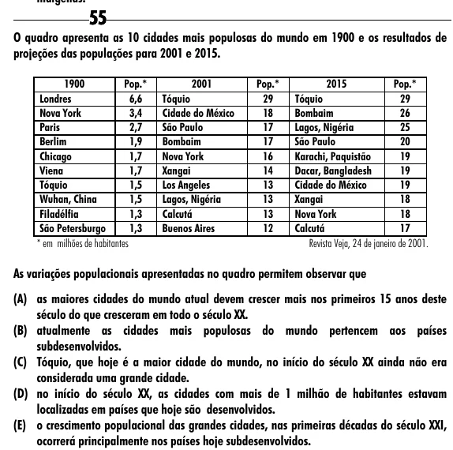

Texto extraído (pode conter ruído)

55  
O quadro apresenta as 10 cidades mais populosas do mundo em 1900 e os resultados de  
projeções das populações para 2001 e 2015.  
1900  
Pop.*  
2001  
Pop.*  
2015  
Pop.*  
Londres  
6,6  
Tóquio  
29  
Tóquio  
29  
Nova York  
3,4  
Cidade do México  
18  
Bombaim  
26  
Paris  
2,7  
São Paulo  
17  
Lagos, Nigéria  
25  
Berlim  
1,9  
Bombaim  
17  
São Paulo  
20  
Chicago  
1,7  
Nova York  
16  
Karachi, Paquistão  
19  
Viena  
1,7  
Xangai  
14  
Dacar, Bangladesh  
19  
Tóquio  
1,5  
Los Angeles  
13  
Cidade do México  
19  
Wuhan, China  
1,5  
Lagos, Nigéria  
13  
Xangai  
18  
Filadélfia  
1,3  
Calcutá  
13  
Nova York  
18  
São Petersburgo  
1,3  
Buenos Aires  
12  
Calcutá  
17  
* em milhões de habitantes  
Revista Veja, 24 de janeiro de 2001.  
As variações populacionais apresentadas no quadro permitem observar que  
(A) as maiores cidades do mundo atual devem crescer mais nos primeiros 15 anos deste  
século do que cresceram em todo o século XX.  
(B) atualmente as cidades mais populosas do mundo pertencem aos países  
subdesenvolvidos.  
(C) Tóquio, que hoje é a maior cidade do mundo, no início do século XX ainda não era  
considerada uma grande cidade.  
(D) no início do século XX, as cidades com mais de 1 milhão de habitantes estavam  
localizadas em países que hoje são desenvolvidos.  
(E) o crescimento populacional das grandes cidades, nas primeiras décadas do século XXI,  
ocorrerá principalmente nos países hoje subdesenvolvidos.

