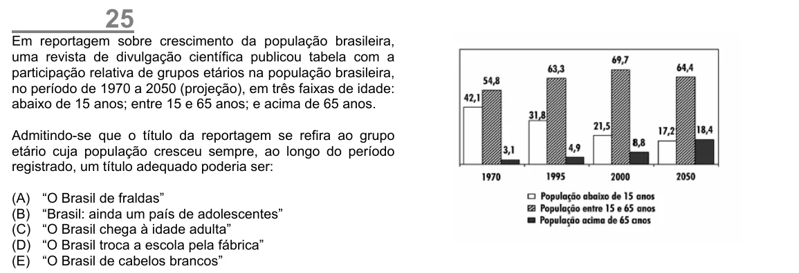

Texto extraído (pode conter ruído)

25  
Em reportagem sobre crescimento da população brasileira,  
uma revista de divulgação científica publicou tabela com a  
participação relativa de grupos etários na população brasileira,  
no período de 1970 a 2050 (projeção), em três faixas de idade:  
abaixo de 15 anos; entre 15 e 65 anos; e acima de 65 anos.  
Admitindo-se que o título da reportagem se refira ao grupo  
etário cuja população cresceu sempre, ao longo do período  
registrado, um título adequado poderia ser:  
(A)  
“O Brasil de fraldas”  
(B)  
“Brasil: ainda um país de adolescentes”  
(C)  
“O Brasil chega à idade adulta”  
(D)  
“O Brasil troca a escola pela fábrica”  
(E)  
“O Brasil de cabelos brancos”

