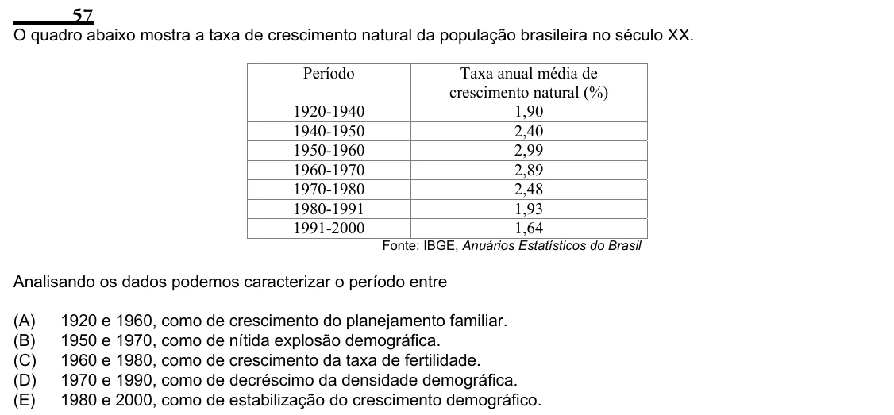

Texto extraído (pode conter ruído)

57  
O quadro abaixo mostra a taxa de crescimento natural da população brasileira no século XX.  
Período  
Taxa anual média de  
crescimento natural (%)  
1920-1940  
1,90  
1940-1950  
2,40  
1950-1960  
2,99  
1960-1970  
2,89  
1970-1980  
2,48  
1980-1991  
1,93  
1991-2000  
1,64  
Fonte: IBGE, Anuários Estatísticos do Brasil  
Analisando os dados podemos caracterizar o período entre  
(A)  
1920 e 1960, como de crescimento do planejamento familiar.  
(B)  
1950 e 1970, como de nítida explosão demográfica.  
(C)  
1960 e 1980, como de crescimento da taxa de fertilidade.  
(D)  
1970 e 1990, como de decréscimo da densidade demográfica.  
(E)  
1980 e 2000, como de estabilização do crescimento demográfico.

