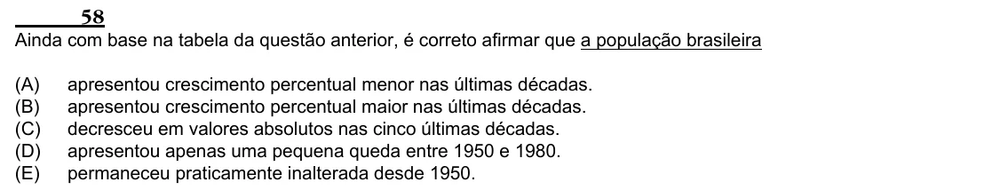

Texto extraído (pode conter ruído)

58  
Ainda com base na tabela da questão anterior, é correto afirmar que a população brasileira  
(A)  
apresentou crescimento percentual menor nas últimas décadas.  
(B)  
apresentou crescimento percentual maior nas últimas décadas.  
(C)  
decresceu em valores absolutos nas cinco últimas décadas.  
(D)  
apresentou apenas uma pequena queda entre 1950 e 1980.  
(E)  
permaneceu praticamente inalterada desde 1950.

