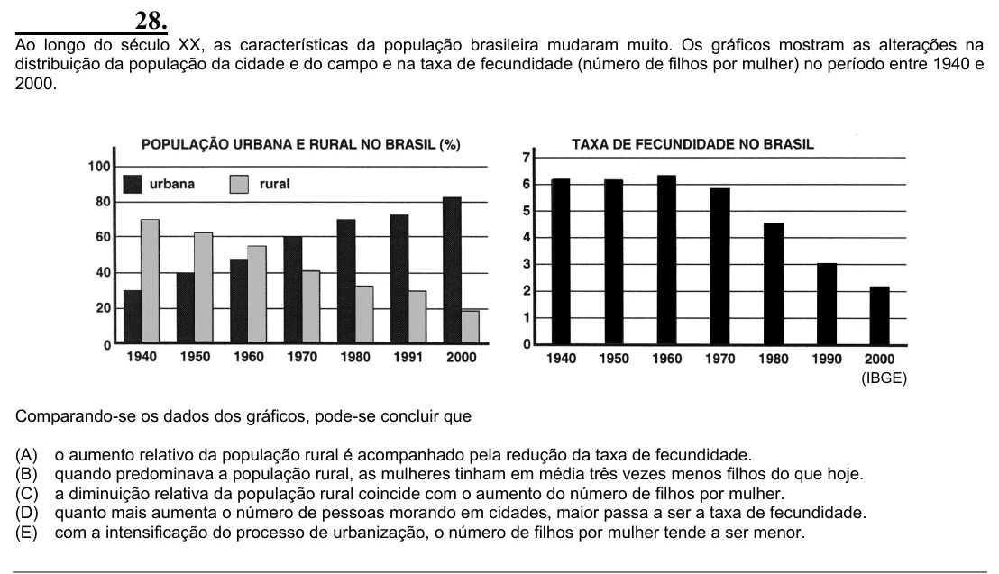

Texto extraído (pode conter ruído)

28.  
Ao longo do século XX, as características da população brasileira mudaram muito. Os gráficos mostram as alterações na  
distribuição da população da cidade e do campo e na taxa de fecundidade (número de filhos por mulher) no período entre 1940 e  
2000.  
(IBGE)  
Comparando-se os dados dos gráficos, pode-se concluir que  
(A)  
o aumento relativo da população rural é acompanhado pela redução da taxa de fecundidade.  
(B)  
quando predominava a população rural, as mulheres tinham em média três vezes menos filhos do que hoje.  
(C)  
a diminuição relativa da população rural coincide com o aumento do número de filhos por mulher.  
(D)  
quanto mais aumenta o número de pessoas morando em cidades, maior passa a ser a taxa de fecundidade.  
(E)  
com a intensificação do processo de urbanização, o número de filhos por mulher tende a ser menor.

