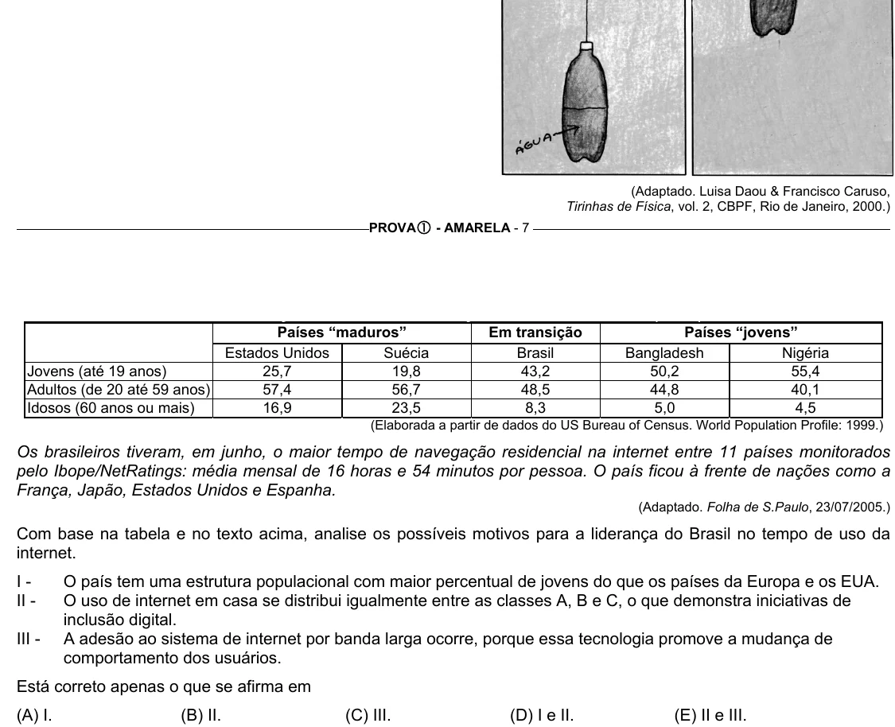

Texto extraído (pode conter ruído)

(Adaptado. Luisa Daou & Francisco Caruso,  
Tirinhas de Física, vol. 2, CBPF, Rio de Janeiro, 2000.)  
PROVA c - AMARELA - 7  
Países “maduros”  
Em transição  
Países “jovens”  
Estados Unidos  
Suécia  
Brasil  
Bangladesh  
Nigéria  
Jovens (até 19 anos)  
25,7  
19,8  
43,2  
50,2  
55,4  
Adultos (de 20 até 59 anos)  
57,4  
56,7  
48,5  
44,8  
40,1  
Idosos (60 anos ou mais)  
16,9  
23,5  
8,3  
5,0  
4,5  
(Elaborada a partir de dados do US Bureau of Census. World Population Profile: 1999.)  
Os brasileiros tiveram, em junho, o maior tempo de navegação residencial na internet entre 11 países monitorados  
pelo Ibope/NetRatings: média mensal de 16 horas e 54 minutos por pessoa. O país ficou à frente de nações como a  
França, Japão, Estados Unidos e Espanha.  
(Adaptado. Folha de S.Paulo, 23/07/2005.)  
Com base na tabela e no texto acima, analise os possíveis motivos para a liderança do Brasil no tempo de uso da  
internet.  
I -  
O país tem uma estrutura populacional com maior percentual de jovens do que os países da Europa e os EUA.  
II -  
O uso de internet em casa se distribui igualmente entre as classes A, B e C, o que demonstra iniciativas de  
inclusão digital.  
III -  
A adesão ao sistema de internet por banda larga ocorre, porque essa tecnologia promove a mudança de  
comportamento dos usuários.  
Está correto apenas o que se afirma em  
(A) I.  
(B) II.  
(C) III.  
(D) I e II.  
(E) II e III.

