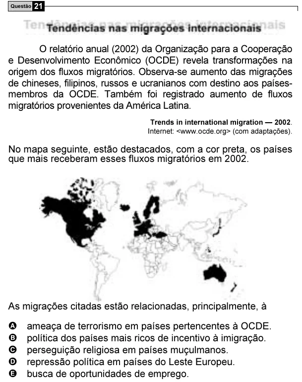

Texto extraído (pode conter ruído)

Questão 21  
O relatório anual (2002) da Organização para a Cooperação  
e Desenvolvimento Econômico (OCDE) revela transformações na  
origem dos fluxos migratórios. Observa-se aumento das migrações  
de chineses, filipinos, russos e ucranianos com destino aos países-  
membros da OCDE. Também foi registrado aumento de fluxos  
migratórios provenientes da América Latina.  
Trends in international migration — 2002.  
Internet: <www.ocde.org> (com adaptações).  
No mapa seguinte, estão destacados, com a cor preta, os países  
que mais receberam esses fluxos migratórios em 2002.  
As migrações citadas estão relacionadas, principalmente, à  
A  
ameaça de terrorismo em países pertencentes à OCDE.  
B  
política dos países mais ricos de incentivo à imigração.  
C  
perseguição religiosa em países muçulmanos.  
D  
repressão política em países do Leste Europeu.  
E  
busca de oportunidades de emprego.

