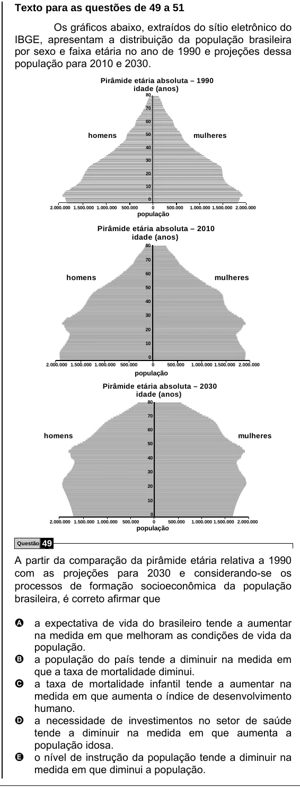

Texto extraído (pode conter ruído)

Texto para as questões de 49 a 51  
Os gráficos abaixo, extraídos do sítio eletrônico do  
IBGE, apresentam a distribuição da população brasileira  
por sexo e faixa etária no ano de 1990 e projeções dessa  
população para 2010 e 2030.  
Pirâmide etária absoluta – 1990  
idade (anos)  
80  
70  
60  
homens  
50  
mulheres  
40  
30  
20  
10  
0  
2.000.000 1.500.000 1.000.000 500.000  
0  
500.000  
1.000.000 1.500.000 2.000.000  
população  
Pirâmide etária absoluta – 2010  
idade (anos)  
80  
70  
60  
homens  
mulheres  
50  
40  
30  
20  
10  
0  
2.000.000 1.500.000 1.000.000 500.000  
0  
500.000  
1.000.000 1.500.000 2.000.000  
população  
Pirâmide etária absoluta – 2030  
idade (anos)  
80  
70  
60  
homens  
mulheres  
50  
40  
30  
20  
10  
0  
2.000.000 1.500.000 1.000.000  
500.000  
0  
500.000  
1.000.000 1.500.000 2.000.000  
população  
Questão  
49  
A partir da comparação da pirâmide etária relativa a 1990  
com as projeções para 2030 e considerando-se os  
processos de formação socioeconômica da população  
brasileira, é correto afirmar que  
A a expectativa de vida do brasileiro tende a aumentar  
na medida em que melhoram as condições de vida da  
população.  
B  
a população do país tende a diminuir na medida em  
que a taxa de mortalidade diminui.  
a taxa de mortalidade infantil tende a aumentar na  
C  
medida em que aumenta o índice de desenvolvimento  
humano.  
a necessidade de investimentos no setor de saúde  
D  
tende a diminuir na medida em que aumenta a  
população idosa.  
o nível de instrução da população tende a diminuir na  
E  
medida em que diminui a população.

