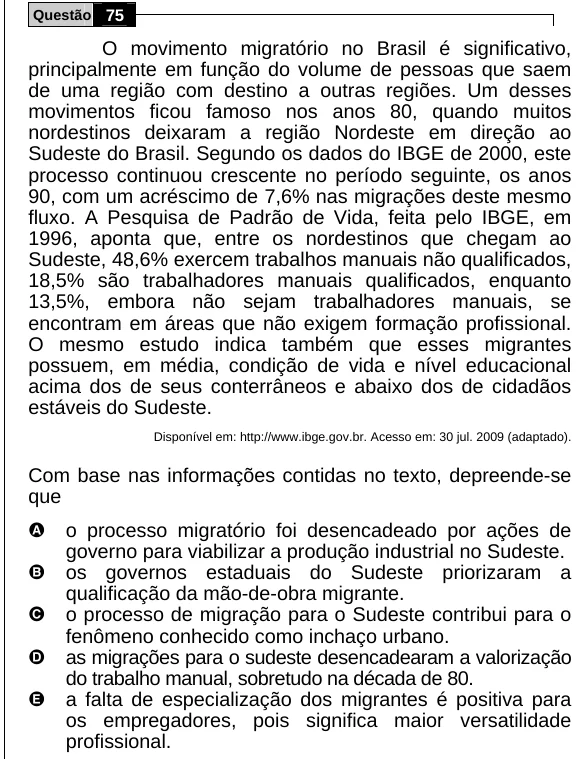

Texto extraído (pode conter ruído)

Questão 75  
O movimento migratório no Brasil é significativo,  
principalmente em função do volume de pessoas que saem  
de uma região com destino a outras regiões. Um desses  
movimentos ficou famoso nos anos 80, quando muitos  
nordestinos deixaram a região Nordeste em direção ao  
Sudeste do Brasil. Segundo os dados do IBGE de 2000, este  
processo continuou crescente no período seguinte, os anos  
90, com um acréscimo de 7,6% nas migrações deste mesmo  
fluxo. A Pesquisa de Padrão de Vida, feita pelo IBGE, em  
1996, aponta que, entre os nordestinos que chegam ao  
Sudeste, 48,6% exercem trabalhos manuais não qualificados,  
18,5% são trabalhadores manuais qualificados, enquanto  
13,5%, embora não sejam trabalhadores manuais, se  
encontram em áreas que não exigem formação profissional.  
O mesmo estudo indica também que esses migrantes  
possuem, em média, condição de vida e nível educacional  
acima dos de seus conterrâneos e abaixo dos de cidadãos  
estáveis do Sudeste.  
Disponível em: http://www.ibge.gov.br. Acesso em: 30 jul. 2009 (adaptado).  
Com base nas informações contidas no texto, depreende-se  
que  
A  
o processo migratório foi desencadeado por ações de  
governo para viabilizar a produção industrial no Sudeste.  
B  
os governos estaduais do Sudeste priorizaram a  
qualificação da mão-de-obra migrante.  
C  
o processo de migração para o Sudeste contribui para o  
fenômeno conhecido como inchaço urbano.  
D  
as migrações para o sudeste desencadearam a valorização  
do trabalho manual, sobretudo na década de 80.  
E  
a falta de especialização dos migrantes é positiva para  
os empregadores, pois significa maior versatilidade  
profissional.

