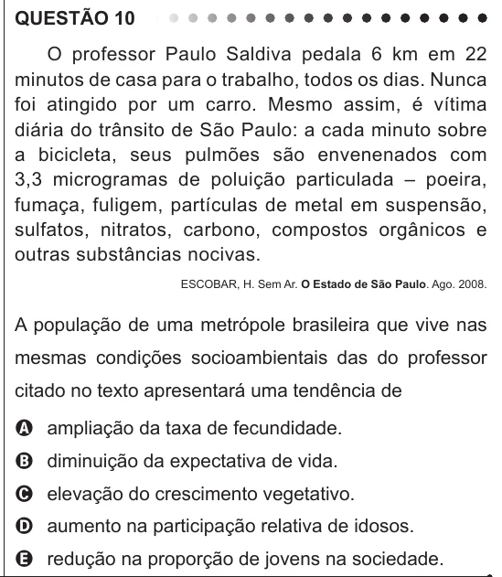

Texto extraído (pode conter ruído)

QUESTÃO 10  
O professor Paulo Saldiva pedala 6 km em 22  
minutos de casa para o trabalho, todos os dias. Nunca  
foi atingido por um carro. Mesmo assim, é vítima  
diária do trânsito de São Paulo: a cada minuto sobre  
a bicicleta, seus pulmões são envenenados com  
3,3 microgramas de poluição particulada – poeira,  
fumaça, fuligem, partículas de metal em suspensão,  
sulfatos, nitratos, carbono, compostos orgânicos e  
outras substâncias nocivas.  
ESCOBAR, H. Sem Ar. O Estado de São Paulo. Ago. 2008.  
A população de uma metrópole brasileira que vive nas  
mesmas condições socioambientais das do professor  
citado no texto apresentará uma tendência de  
A ampliação da taxa de fecundidade.  
B diminuição da expectativa de vida.  
C elevação do crescimento vegetativo.  
D aumento na participação relativa de idosos.  
E redução na proporção de jovens na sociedade.

