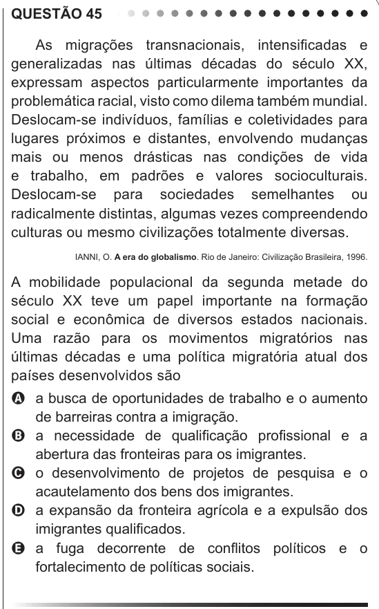

Texto extraído (pode conter ruído)

QUESTÃO 45  
As migrações transnacionais, intensificadas e  
generalizadas nas últimas décadas do século XX,  
expressam aspectos particularmente importantes da  
problemática racial, visto como dilema também mundial.  
Deslocam-se indivíduos, famílias e coletividades para  
lugares próximos e distantes, envolvendo mudanças  
mais ou menos drásticas nas condições de vida  
e trabalho, em padrões e valores socioculturais.  
Deslocam-se para sociedades semelhantes ou  
radicalmente distintas, algumas vezes compreendendo  
culturas ou mesmo civilizações totalmente diversas.  
IANNI, O. A era do globalismo. Rio de Janeiro: Civilização Brasileira, 1996.  
A mobilidade populacional da segunda metade do  
século XX teve um papel importante na formação  
social e econômica de diversos estados nacionais.  
Uma razão para os movimentos migratórios nas  
últimas décadas e uma política migratória atual dos  
países desenvolvidos são  
A a busca de oportunidades de trabalho e o aumento  
de barreiras contra a imigração.  
B a necessidade de qualificação profissional e a  
abertura das fronteiras para os imigrantes.  
C o desenvolvimento de projetos de pesquisa e o  
acautelamento dos bens dos imigrantes.  
D a expansão da fronteira agrícola e a expulsão dos  
imigrantes qualificados.  
E a fuga decorrente de conflitos políticos e o  
fortalecimento de políticas sociais.  
CIÊNCIAS DA NATUREZA E SUAS  
TECNOLOGIAS  
Questões de 46 a 90

