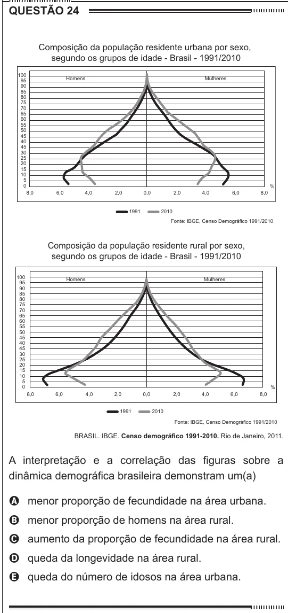

Texto extraído (pode conter ruído)

QUESTÃO 24  
Composição da população residente urbana por sexo,  
segundo os grupos de idade - Brasil - 1991/2010  
100  
95  
Homens  
Mulheres  
90  
85  
80  
75  
70  
65  
60  
55  
50  
45  
40  
45  
30  
25  
20  
15  
10  
5  
0  
%  
8,0  
6,0  
4,0  
2,0  
0,0  
2,0  
4,0  
6,0  
8,0  
1991  
2010  
Fonte: IBGE, Censo Demográfico 1991/2010  
Composição da população residente rural por sexo,  
segundo os grupos de idade - Brasil - 1991/2010  
100  
Homens  
Mulheres  
95  
90  
85  
80  
75  
70  
65  
60  
55  
50  
45  
40  
45  
30  
25  
20  
15  
10  
5  
0  
%  
8,0  
6,0  
4,0  
2,0  
0,0  
2,0  
4,0  
6,0  
8,0  
1991  
2010  
Fonte: IBGE, Censo Demográfico 1991/2010  
BRASIL. IBGE. Censo demográfico 1991-2010. Rio de Janeiro, 2011.  
A interpretação e a correlação das figuras sobre a  
dinâmica demográfica brasileira demonstram um(a)  
A menor proporção de fecundidade na área urbana.  
B menor proporção de homens na área rural.  
C aumento da proporção de fecundidade na área rural.  
D queda da longevidade na área rural.  
E queda do número de idosos na área urbana.

