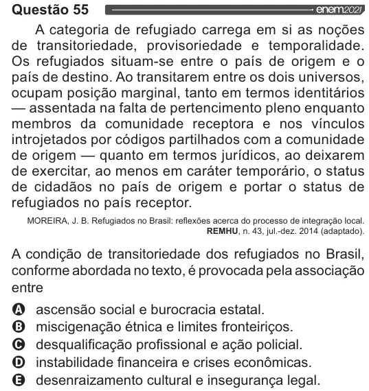

Texto extraído (pode conter ruído)

Questão 55  
A categoria de refugiado carrega em si as noções  
de transitoriedade, provisoriedade e temporalidade.  
Os refugiados situam-se entre o país de origem e o  
país de destino. Ao transitarem entre os dois universos,  
ocupam posição marginal, tanto em termos identitários  
— assentada na falta de pertencimento pleno enquanto  
membros da comunidade receptora e nos vínculos  
introjetados por códigos partilhados com a comunidade  
de origem — quanto em termos jurídicos, ao deixarem  
de exercitar, ao menos em caráter temporário, o status  
de cidadãos no país de origem e portar o status de  
refugiados no país receptor.  
MOREIRA, J. B. Refugiados no Brasil: reflexões acerca do processo de integração local.  
REMHU, n. 43, jul.-dez. 2014 (adaptado).  
A condição de transitoriedade dos refugiados no Brasil,  
conforme abordada no texto, é provocada pela associação  
OQ ascensão social e burocracia estatal.  
O miscigenação étnica e limites fronteiriços.  
O desqualificação profissional e ação policial.  
O instabilidade financeira e crises econômicas.  
& desenraizamento cultural e insegurança legal.

