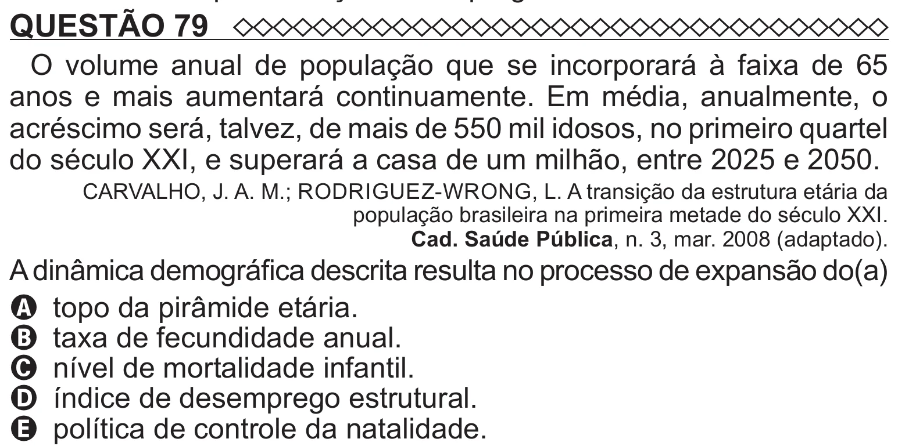

Texto extraído (pode conter ruído)

QUESTÃO 79  
O volume anual de população que se incorporará à faixa de 65  
anos e mais aumentará continuamente. Em média, anualmente, o  
acréscimo será, talvez, de mais de 550 mil idosos, no primeiro quartel  
do século XXI, e superará a casa de um milhão, entre 2025 e 2050.  
CARVALHO, J. A. M.; RODRIGUEZ-WRONG, L. A transição da estrutura etária da  
população brasileira na primeira metade do século XXI.  
Cad. Saúde Pública, n. 3, mar. 2008 (adaptado).  
A dinâmica demográfica descrita resulta no processo de expansão do(a)  
A topo da pirâmide etária.  
B taxa de fecundidade anual.  
C nível de mortalidade infantil.  
D índice de desemprego estrutural.

