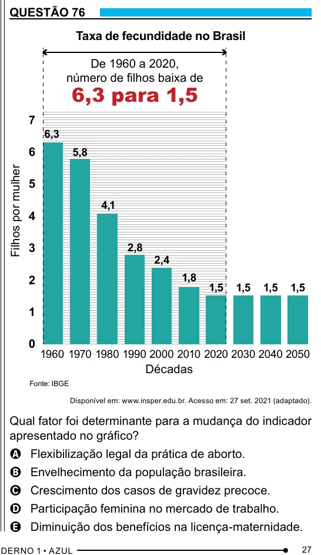

Texto extraído (pode conter ruído)

QUESTÃO 76  
Taxa de fecundidade no Brasil  
De 1960 a 2020,  
número de filhos baixa de  
6,3 para 1,5  
7  
6,3  
6  
5,8  
Filhos por mulher  
5  
4,1  
4  
3  
2,8  
2,4  
1,8  
2  
1,5  
1,5  
1,5  
1,5  
1  
0  
1960 1970 1980 1990 2000 2010 2020 2030 2040 2050  
Décadas  
Fonte: IBGE  
Disponível em: www.insper.edu.br. Acesso em: 27 set. 2021 (adaptado).  
Qual fator foi determinante para a mudança do indicador  
apresentado no gráfico?  
A Flexibilização legal da prática de aborto.  
B Envelhecimento da população brasileira.  
C Crescimento dos casos de gravidez precoce.  
D Participação feminina no mercado de trabalho.  
E Diminuição dos benefícios na licença-maternidade.  
27

