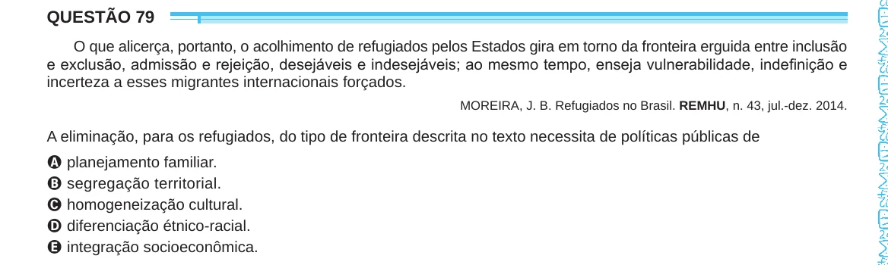

Texto extraído (pode conter ruído)

QUESTÃO 79  
O que alicerça, portanto, o acolhimento de refugiados pelos Estados gira em torno da fronteira erguida entre inclusão  
e exclusão, admissão e rejeição, desejáveis e indesejáveis; ao mesmo tempo, enseja vulnerabilidade, indefinição e  
incerteza a esses migrantes internacionais forçados.  
MOREIRA, J. B. Refugiados no Brasil. REMHU, n. 43, jul.-dez. 2014.  
A eliminação, para os refugiados, do tipo de fronteira descrita no texto necessita de políticas públicas de  
A planejamento familiar.  
B segregação territorial.  
C homogeneização cultural.  
D diferenciação étnico-racial.  
E integração socioeconômica.

