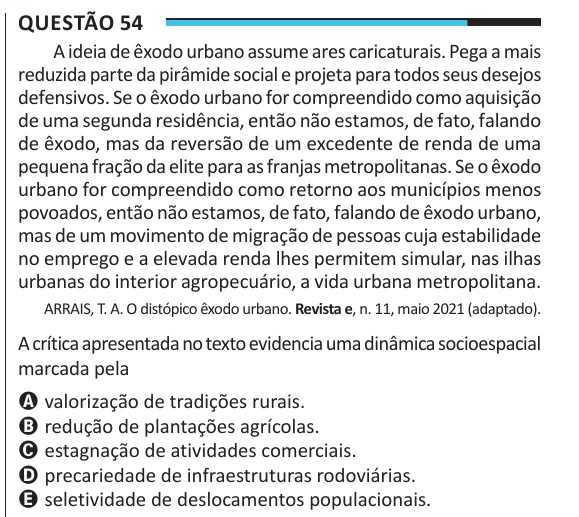

Texto extraído (pode conter ruído)

Questão 54  
A ideia de êxodo urbano assume ares caricaturais. Pega a mais  
reduzida parte da pirâmide social e projeta para todos seus desejos  
defensivos. Se o êxodo urbano for compreendido como aquisição  
de uma segunda residência, então não estamos, de fato, falando  
de êxodo, mas da reversão de um excedente de renda de uma  
pequena fração da elite para as franjas metropolitanas. Se o êxodo  
urbano for compreendido como retorno aos municípios menos  
povoados, então não estamos, de fato, falando de êxodo urbano,  
mas de um movimento de migração de pessoas cuja estabilidade  
no emprego e a elevada renda lhes permitem simular, nas ilhas  
urbanas do interior agropecuário, a vida urbana metropolitana.  
ARRAIS, T. A. O distópico êxodo urbano. Revista e, n. 11, maio 2021 (adaptado).  
A crítica apresentada no texto evidencia uma dinâmica socioespacial  
marcada pela  
A valorização de tradições rurais.  
B redução de plantações agrícolas.  
C estagnação de atividades comerciais.  
D precariedade de infraestruturas rodoviárias.  
E seletividade de deslocamentos populacionais.

