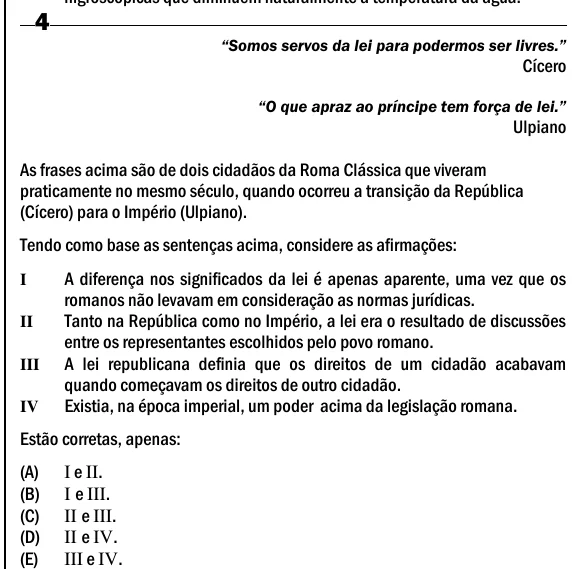

Texto extraído (pode conter ruído)

4  
―Somos servos da lei para podermos ser livres.‖  
Cícero  
―O que apraz ao príncipe tem força de lei.‖  
Ulpiano  
As frases acima são de dois cidadãos da Roma Clássica que viveram  
praticamente no mesmo século, quando ocorreu a transição da República  
(Cícero) para o Império (Ulpiano).  
Tendo como base as sentenças acima, considere as afirmações:  
A diferença nos significados da lei é apenas aparente, uma vez que os  
I  
romanos não levavam em consideração as normas jurídicas.  
Tanto na República como no Império, a lei era o resultado de discussões  
II  
entre os representantes escolhidos pelo povo romano.  
A lei republicana definia que os direitos de um cidadão acabavam  
III  
quando começavam os direitos de outro cidadão.  
Existia, na época imperial, um poder acima da legislação romana.  
IV  
Estão corretas, apenas:  
(A)  
I e II.  
(B)  
I e III.  
(C)  
II e III.  
(D)  
II e IV.  
(E)  
III e IV.

