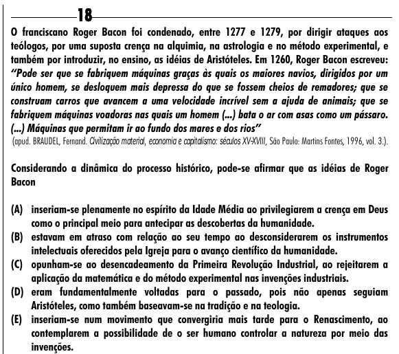

Texto extraído (pode conter ruído)

18  
O franciscano Roger Bacon foi condenado, entre 1277 e 1279, por dirigir ataques aos  
teólogos, por uma suposta crença na alquimia, na astrologia e no método experimental, e  
também por introduzir, no ensino, as idéias de Aristóteles. Em 1260, Roger Bacon escreveu:  
“Pode ser que se fabriquem máquinas graças às quais os maiores navios, dirigidos por um  
único homem, se desloquem mais depressa do que se fossem cheios de remadores; que se  
construam carros que avancem a uma velocidade incrível sem a ajuda de animais; que se  
fabriquem máquinas voadoras nas quais um homem (...) bata o ar com asas como um pássaro.  
(...) Máquinas que permitam ir ao fundo dos mares e dos rios”  
(apud. BRAUDEL, Fernand. Civilização material, economia e capitalismo: séculos XV-XVIII, São Paulo: Martins Fontes, 1996, vol. 3.).  
Considerando a dinâmica do processo histórico, pode-se afirmar que as idéias de Roger  
Bacon  
(A) inseriam-se plenamente no espírito da Idade Média ao privilegiarem a crença em Deus  
como o principal meio para antecipar as descobertas da humanidade.  
(B) estavam em atraso com relação ao seu tempo ao desconsiderarem os instrumentos  
intelectuais oferecidos pela Igreja para o avanço científico da humanidade.  
(C) opunham-se ao desencadeamento da Primeira Revolução Industrial, ao rejeitarem a  
aplicação da matemática e do método experimental nas invenções industriais.  
(D) eram fundamentalmente voltadas para o passado, pois não apenas seguiam  
Aristóteles, como também baseavam-se na tradição e na teologia.  
(E) inseriam-se num movimento que convergiria mais tarde para o Renascimento, ao  
contemplarem a possibilidade de o ser humano controlar a natureza por meio das  
invenções.

