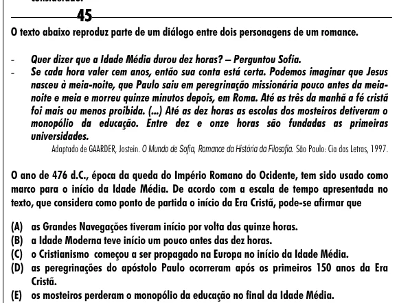

Texto extraído (pode conter ruído)

45  
O texto abaixo reproduz parte de um diálogo entre dois personagens de um romance.  
-  
Quer dizer que a Idade Média durou dez horas? – Perguntou Sofia.  
-  
Se cada hora valer cem anos, então sua conta está certa. Podemos imaginar que Jesus  
nasceu à meia-noite, que Paulo saiu em peregrinação missionária pouco antes da meia-  
noite e meia e morreu quinze minutos depois, em Roma. Até as três da manhã a fé cristã  
foi mais ou menos proibida. (...) Até as dez horas as escolas dos mosteiros detiveram o  
monopólio da educação. Entre dez e onze horas são fundadas as primeiras  
universidades.  
Adaptado de GAARDER, Jostein. O Mundo de Sofia, Romance da História da Filosofia. São Paulo: Cia das Letras, 1997.  
O ano de 476 d.C., época da queda do Império Romano do Ocidente, tem sido usado como  
marco para o início da Idade Média. De acordo com a escala de tempo apresentada no  
texto, que considera como ponto de partida o início da Era Cristã, pode-se afirmar que  
(A) as Grandes Navegações tiveram início por volta das quinze horas.  
(B) a Idade Moderna teve início um pouco antes das dez horas.  
(C) o Cristianismo começou a ser propagado na Europa no início da Idade Média.  
(D) as peregrinações do apóstolo Paulo ocorreram após os primeiros 150 anos da Era  
Cristã.  
(E) os mosteiros perderam o monopólio da educação no final da Idade Média.

