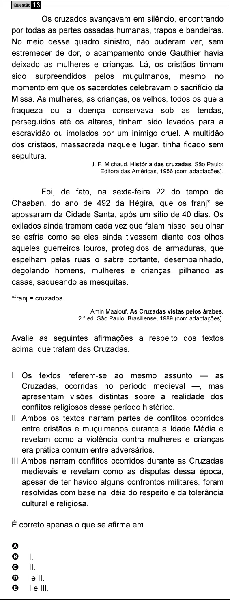

Texto extraído (pode conter ruído)

Questão 13  
Os cruzados avançavam em silêncio, encontrando  
por todas as partes ossadas humanas, trapos e bandeiras.  
No meio desse quadro sinistro, não puderam ver, sem  
estremecer de dor, o acampamento onde Gauthier havia  
deixado as mulheres e crianças. Lá, os cristãos tinham  
sido surpreendidos pelos muçulmanos, mesmo no  
momento em que os sacerdotes celebravam o sacrifício da  
Missa. As mulheres, as crianças, os velhos, todos os que a  
fraqueza ou a doença conservava sob as tendas,  
perseguidos até os altares, tinham sido levados para a  
escravidão ou imolados por um inimigo cruel. A multidão  
dos cristãos, massacrada naquele lugar, tinha ficado sem  
sepultura.  
J. F. Michaud. História das cruzadas. São Paulo:  
Editora das Américas, 1956 (com adaptações).  
Foi, de fato, na sexta-feira 22 do tempo de  
Chaaban, do ano de 492 da Hégira, que os franj* se  
apossaram da Cidade Santa, após um sítio de 40 dias. Os  
exilados ainda tremem cada vez que falam nisso, seu olhar  
se esfria como se eles ainda tivessem diante dos olhos  
aqueles guerreiros louros, protegidos de armaduras, que  
espelham pelas ruas o sabre cortante, desembainhado,  
degolando homens, mulheres e crianças, pilhando as  
casas, saqueando as mesquitas.  
*franj = cruzados.  
Amin Maalouf. As Cruzadas vistas pelos árabes.  
2.ª ed. São Paulo: Brasiliense, 1989 (com adaptações).  
Avalie as seguintes afirmações a respeito dos textos  
acima, que tratam das Cruzadas.  
I Os textos referem-se ao mesmo assunto — as  
Cruzadas, ocorridas no período medieval —, mas  
apresentam visões distintas sobre a realidade dos  
conflitos religiosos desse período histórico.  
II Ambos os textos narram partes de conflitos ocorridos  
entre cristãos e muçulmanos durante a Idade Média e  
revelam como a violência contra mulheres e crianças  
era prática comum entre adversários.  
III Ambos narram conflitos ocorridos durante as Cruzadas  
medievais e revelam como as disputas dessa época,  
apesar de ter havido alguns confrontos militares, foram  
resolvidas com base na idéia do respeito e da tolerância  
cultural e religiosa.  
É correto apenas o que se afirma em  
A  
I.  
B  
II.  
C  
III.  
D  
I e II.  
E  
II e III.

