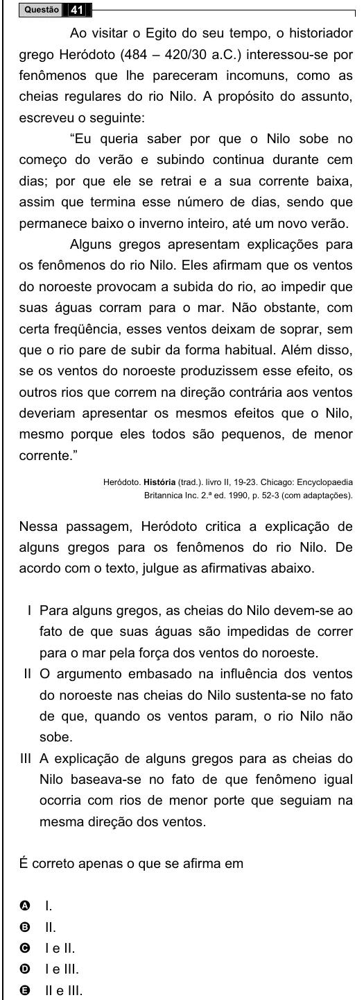

Texto extraído (pode conter ruído)

41  
Questão  
Ao visitar o Egito do seu tempo, o historiador  
grego Heródoto (484 – 420/30 a.C.) interessou-se por  
fenômenos que lhe pareceram incomuns, como as  
cheias regulares do rio Nilo. A propósito do assunto,  
escreveu o seguinte:  
“Eu queria saber por que o Nilo sobe no  
começo do verão e subindo continua durante cem  
dias; por que ele se retrai e a sua corrente baixa,  
assim que termina esse número de dias, sendo que  
permanece baixo o inverno inteiro, até um novo verão.  
Alguns gregos apresentam explicações para  
os fenômenos do rio Nilo. Eles afirmam que os ventos  
do noroeste provocam a subida do rio, ao impedir que  
suas águas corram para o mar. Não obstante, com  
certa freqüência, esses ventos deixam de soprar, sem  
que o rio pare de subir da forma habitual. Além disso,  
se os ventos do noroeste produzissem esse efeito, os  
outros rios que correm na direção contrária aos ventos  
deveriam apresentar os mesmos efeitos que o Nilo,  
mesmo porque eles todos são pequenos, de menor  
corrente.”  
Heródoto. História (trad.). livro II, 19-23. Chicago: Encyclopaedia  
Britannica Inc. 2.ª ed. 1990, p. 52-3 (com adaptações).  
Nessa passagem, Heródoto critica a explicação de  
alguns gregos para os fenômenos do rio Nilo. De  
acordo com o texto, julgue as afirmativas abaixo.  
I Para alguns gregos, as cheias do Nilo devem-se ao  
fato de que suas águas são impedidas de correr  
para o mar pela força dos ventos do noroeste.  
II O argumento embasado na influência dos ventos  
do noroeste nas cheias do Nilo sustenta-se no fato  
de que, quando os ventos param, o rio Nilo não  
sobe.  
III A explicação de alguns gregos para as cheias do  
Nilo baseava-se no fato de que fenômeno igual  
ocorria com rios de menor porte que seguiam na  
mesma direção dos ventos.  
É correto apenas o que se afirma em  
I.  
A  
II.  
B  
I e II.  
C  
D  
I e III.  
E  
II e III.

