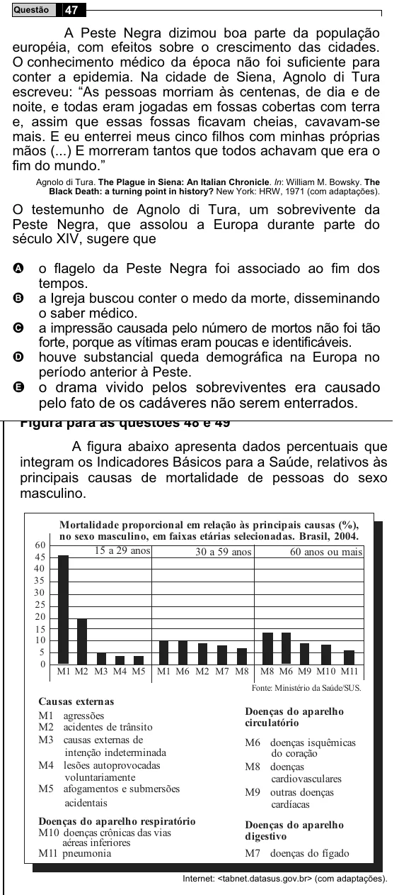

Texto extraído (pode conter ruído)

Questão  
47  
A Peste Negra dizimou boa parte da população  
européia, com efeitos sobre o crescimento das cidades.  
O conhecimento médico da época não foi suficiente para  
conter a epidemia. Na cidade de Siena, Agnolo di Tura  
escreveu: “As pessoas morriam às centenas, de dia e de  
noite, e todas eram jogadas em fossas cobertas com terra  
e, assim que essas fossas ficavam cheias, cavavam-se  
mais. E eu enterrei meus cinco filhos com minhas próprias  
mãos (...) E morreram tantos que todos achavam que era o  
fim do mundo.”  
Agnolo di Tura. The Plague in Siena: An Italian Chronicle. In: William M. Bowsky. The  
Black Death: a turning point in history? New York: HRW, 1971 (com adaptações).  
O testemunho de Agnolo di Tura, um sobrevivente da  
Peste Negra, que assolou a Europa durante parte do  
século XIV, sugere que  
o flagelo da Peste Negra foi associado ao fim dos  
A  
tempos.  
B  
a Igreja buscou conter o medo da morte, disseminando  
o saber médico.  
a impressão causada pelo número de mortos não foi tão  
C  
forte, porque as vítimas eram poucas e identificáveis.  
houve substancial queda demográfica na Europa no  
D  
período anterior à Peste.  
E o drama vivido pelos sobreviventes era causado  
pelo fato de os cadáveres não serem enterrados.  
A figura abaixo apresenta dados percentuais que  
integram os Indicadores Básicos para a Saúde, relativos às  
principais causas de mortalidade de pessoas do sexo  
masculino.  
Mortalidade proporcional em relação às principais causas (%),  
no sexo masculino, em faixas etárias selecionadas. Brasil, 2004.  
60  
15 a 29 anos  
30 a 59 anos  
60 anos ou mais  
45  
40  
35  
30  
25  
20  
15  
10  
5  
0  
M1 M2 M3 M4 M5  
M1 M6 M2 M7 M8  
M8 M6 M9 M10 M11  
Fonte: Ministério da Saúde/SUS.  
Causas externas  
Doenças do aparelho  
M1 agressões  
circulatório  
M2 acidentes de trânsito  
M3 causas externas de  
M6 doenças isquêmicas  
intenção indeterminada  
do coração  
M4 lesões autoprovocadas  
M8 doenças  
voluntariamente  
cardiovasculares  
M5 afogamentos e submersões  
M9 outras doenças  
acidentais  
cardíacas  
Doenças do aparelho respiratório  
Doenças do aparelho  
M10 doenças crônicas das vias  
digestivo  
aéreas inferiores  
M11 pneumonia  
M7 doenças do fígado  
Internet: <tabnet.datasus.gov.br> (com adaptações).

