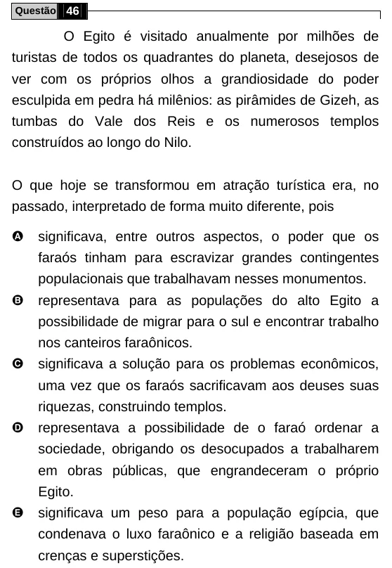

Texto extraído (pode conter ruído)

Questão 46  
O Egito é visitado anualmente por milhões de  
turistas de todos os quadrantes do planeta, desejosos de  
ver com os próprios olhos a grandiosidade do poder  
esculpida em pedra há milênios: as pirâmides de Gizeh, as  
tumbas do Vale dos Reis e os numerosos templos  
construídos ao longo do Nilo.  
O que hoje se transformou em atração turística era, no  
passado, interpretado de forma muito diferente, pois  
A  
significava, entre outros aspectos, o poder que os  
faraós tinham para escravizar grandes contingentes  
populacionais que trabalhavam nesses monumentos.  
B  
representava para as populações do alto Egito a  
possibilidade de migrar para o sul e encontrar trabalho  
nos canteiros faraônicos.  
C  
significava a solução para os problemas econômicos,  
uma vez que os faraós sacrificavam aos deuses suas  
riquezas, construindo templos.  
D  
representava a possibilidade de o faraó ordenar a  
sociedade, obrigando os desocupados a trabalharem  
em obras públicas, que engrandeceram o próprio  
Egito.  
E  
significava um peso para a população egípcia, que  
condenava o luxo faraônico e a religião baseada em  
crenças e superstições.

