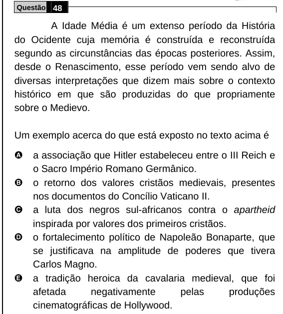

Texto extraído (pode conter ruído)

Questão 48  
A Idade Média é um extenso período da História  
do Ocidente cuja memória é construída e reconstruída  
segundo as circunstâncias das épocas posteriores. Assim,  
desde o Renascimento, esse período vem sendo alvo de  
diversas interpretações que dizem mais sobre o contexto  
histórico em que são produzidas do que propriamente  
sobre o Medievo.  
Um exemplo acerca do que está exposto no texto acima é  
A  
a associação que Hitler estabeleceu entre o III Reich e  
o Sacro Império Romano Germânico.  
B  
o retorno dos valores cristãos medievais, presentes  
nos documentos do Concílio Vaticano II.  
a luta dos negros sul-africanos contra o apartheid  
C  
inspirada por valores dos primeiros cristãos.  
D  
o fortalecimento político de Napoleão Bonaparte, que  
se justificava na amplitude de poderes que tivera  
Carlos Magno.  
E  
a tradição heroica da cavalaria medieval, que foi  
afetada  
negativamente  
pelas  
produções  
cinematográficas de Hollywood.

