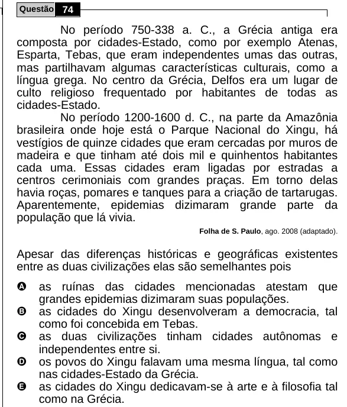

Texto extraído (pode conter ruído)

Questão 74  
No período 750-338 a. C., a Grécia antiga era  
composta por cidades-Estado, como por exemplo Atenas,  
Esparta, Tebas, que eram independentes umas das outras,  
mas partilhavam algumas características culturais, como a  
língua grega. No centro da Grécia, Delfos era um lugar de  
culto religioso frequentado por habitantes de todas as  
cidades-Estado.  
No período 1200-1600 d. C., na parte da Amazônia  
brasileira onde hoje está o Parque Nacional do Xingu, há  
vestígios de quinze cidades que eram cercadas por muros de  
madeira e que tinham até dois mil e quinhentos habitantes  
cada uma. Essas cidades eram ligadas por estradas a  
centros cerimoniais com grandes praças. Em torno delas  
havia roças, pomares e tanques para a criação de tartarugas.  
Aparentemente, epidemias dizimaram grande parte da  
população que lá vivia.  
Folha de S. Paulo, ago. 2008 (adaptado).  
Apesar das diferenças históricas e geográficas existentes  
entre as duas civilizações elas são semelhantes pois  
A  
as ruínas das cidades mencionadas atestam que  
grandes epidemias dizimaram suas populações.  
B  
as cidades do Xingu desenvolveram a democracia, tal  
como foi concebida em Tebas.  
C  
as duas civilizações tinham cidades autônomas e  
independentes entre si.  
D  
os povos do Xingu falavam uma mesma língua, tal como  
nas cidades-Estado da Grécia.  
E  
as cidades do Xingu dedicavam-se à arte e à filosofia tal  
como na Grécia.

