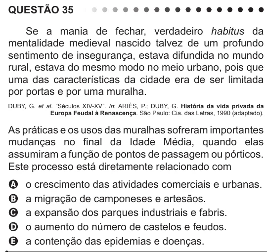

Texto extraído (pode conter ruído)

QUESTÃO 35  
Se a mania de fechar, verdadeiro habitus da  
mentalidade medieval nascido talvez de um profundo  
sentimento de insegurança, estava difundida no mundo  
rural, estava do mesmo modo no meio urbano, pois que  
uma das características da cidade era de ser limitada  
por portas e por uma muralha.  
DUBY, G. et al. “Séculos XIV-XV”. In: ARIÈS, P.; DUBY, G. História da vida privada da  
Europa Feudal à Renascença. São Paulo: Cia. das Letras, 1990 (adaptado).  
As práticas e os usos das muralhas sofreram importantes  
mudanças no final da Idade Média, quando elas  
assumiram a função de pontos de passagem ou pórticos.  
Este processo está diretamente relacionado com  
o crescimento das atividades comerciais e urbanas.  
A  
a migração de camponeses e artesãos.  
B  
C  
a expansão dos parques industriais e fabris.  
o aumento do número de castelos e feudos.  
D  
a contenção das epidemias e doenças.  
E

