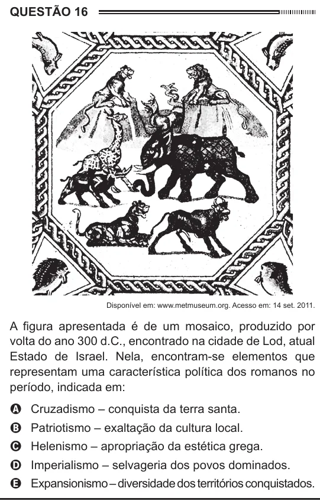

Texto extraído (pode conter ruído)

QUESTÃO 16  
Disponível em: www.metmuseum.org. Acesso em: 14 set. 2011.  
A figura apresentada é de um mosaico, produzido por  
volta do ano 300 d.C., encontrado na cidade de Lod, atual  
Estado de Israel. Nela, encontram-se elementos que  
representam uma característica política dos romanos no  
período, indicada em:  
A Cruzadismo – conquista da terra santa.  
B Patriotismo – exaltação da cultura local.  
C Helenismo – apropriação da estética grega.  
D Imperialismo – selvageria dos povos dominados.  
E Expansionismo – diversidade dos territórios conquistados.

