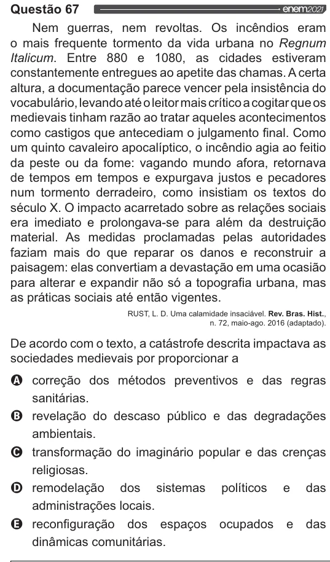

Texto extraído (pode conter ruído)

Questão 67  
Nem guerras, nem revoltas. Os incêndios eram  
o mais frequente tormento da vida urbana no Regnum  
ltalicum. Entre 880 e 1080, as cidades estiveram  
constantemente entregues ao apetite das chamas. A certa  
altura, a documentação parece vencer pela insistência do  
vocabulário, levando até o leitor mais crítico a cogitar que os  
medievais tinham razão ao tratar aqueles acontecimentos  
como castigos que antecediam o julgamento final. Como  
um quinto cavaleiro apocalíptico, o incêndio agia ao feitio  
da peste ou da fome: vagando mundo afora, retornava  
de tempos em tempos e expurgava justos e pecadores  
num tormento derradeiro, como insistiam os textos do  
século X. O impacto acarretado sobre as relações sociais  
era imediato e prolongava-se para além da destruição  
material. As medidas proclamadas pelas autoridades  
faziam mais do que reparar os danos e reconstruir a  
paisagem: elas convertiam a devastação em uma ocasião  
para alterar e expandir não só a topografia urbana, mas  
as práticas sociais até então vigentes.  
RUST, L. D. Uma calamidade insaciável. Rev. Bras. Hist.,  
n. 72, maio-ago. 2016 (adaptado).  
De acordo com o texto, a catástrofe descrita impactava as  
sociedades medievais por proporcionar a  
O correção dos métodos preventivos e das regras  
sanitárias.  
oo O v  
revelação do descaso público e das degradações  
ambientais.  
transformação do imaginário popular e das crenças  
religiosas.  
remodelação dos sistemas das  
políticos e  
administrações locais.  
reconfiguração dos espaços ocupados e das  
dinâmicas comunitárias.

