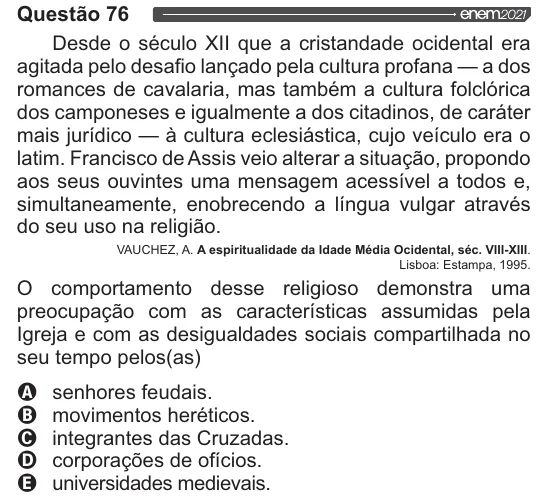

Texto extraído (pode conter ruído)

Questão 76  
Desde o século XII que a cristandade ocidental era  
agitada pelo desafio lançado pela cultura profana — a dos  
romances de cavalaria, mas também a cultura folclórica  
dos camponeses e igualmente a dos citadinos, de caráter  
mais jurídico — à cultura eclesiástica, cujo veículo era o  
latim. Francisco de Assis veio alterar a situação, propondo  
aos seus ouvintes uma mensagem acessível a todos e,  
simultaneamente, enobrecendo a língua vulgar através  
do seu uso na religião.  
VAUCHEZ, A. A espiritualidade da Idade Média Ocidental, séc. VIII-XIII.  
Lisboa: Estampa, 1995.  
O comportamento desse religioso demonstra uma  
preocupação com as características assumidas pela  
Igreja e com as desigualdades sociais compartilhada no  
seu tempo pelos(as)  
VOVOO  
senhores feudais.  
movimentos heréticos.  
integrantes das Cruzadas.  
corporações de ofícios.  
universidades medievais.

